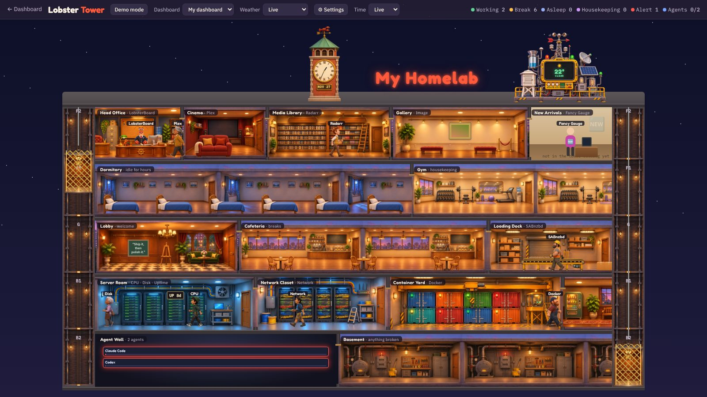

# 🏢 Lobster Tower

**A [LobsterBoard](https://github.com/Curbob/LobsterBoard) add-on that turns your dashboard into a cutaway building.** Every widget on your dashboard becomes a room, and each service gets its own avatar, tagged with the service's name, that shows what it's doing right now.



## What you'll see

- **Working** avatars are at their station: SABnzbd loads boxes onto a conveyor while downloading, Plex sits in the cinema while someone is streaming, the CPU tech works the racks when the server is busy.
- **Breaks** happen in the cafeteria when there's nothing to do. After a long quiet spell (2 hours by default) the avatar heads to bed in the dormitory, with sleeping bags when the beds run out.
- **Housekeeping** (repairs, unpacking, warnings) sends avatars to the gym.
- **Trouble** sends the avatar to the basement and flashes its room red: a service that's unreachable, a disk over 90%, a LobsterBoard update waiting (Mr. Claws panics in his office).
- Avatars walk between rooms and ride the **elevators at both ends**, several at a time.
- **AI coding tools** (Claude Code, Codex, Cursor and friends) are glowing panels on the **Agent Wall**: amber near a limit, red when rate limited or logged out.
- **The building itself** shows the rest: a clock tower with the time and date, a rooftop weather station showing your real weather, the sky following the time of day, your Header text as the neon roof sign, your images in a gallery, your notes on a cork board and the quote of the day on a lobby chalkboard.
- **Click any room** for its widgets' live readouts.

## Install

The tower is a LobsterBoard [custom page](https://github.com/Curbob/LobsterBoard/blob/main/pages/README.md). From the folder you run LobsterBoard in:

```bash
git clone https://github.com/Curbob/lobsterboard-tower pages/tower
```

Restart LobsterBoard, then open **Lobster Tower** from the pages menu (or go to `/pages/tower/`). The folder must be named `tower`.

To update later:

```bash
git -C pages/tower pull
```

## Settings

Click **⚙ Settings** in the tower's top bar:

- **Sleep time**: how long a service has to be idle before its avatar goes to bed.
- **Rooms**: switch any room off to leave it out of the tower. Its widgets stay on your dashboard.

Settings are saved on your LobsterBoard server (`data/tower/settings.json`), so every browser sees the same tower.

## Demo mode

Don't have the services running? Click **Demo mode**, or open `/pages/tower/?demo=1`, to fill every room with made-up activity. The **Dashboard** menu also has sample setups (Media server, Homelab, Developer, Everything).

## New widgets

Every LobsterBoard widget is listed in [`js/catalog.js`](js/catalog.js): the room it lives in, its avatar (or how it appears on the walls), and which states apply. A widget the tower doesn't know yet, from a newer LobsterBoard or a community widget, shows up in the **New Arrivals** room with a stand-in avatar instead of being left out.

The tests check the catalog against the newest LobsterBoard release every week, so a new widget that still needs a room shows up as a failing check here.

## Development

```bash
npm install
npm test
```

- `index.html`: the page.
- `js/catalog.js`: where every widget lives.
- `js/engine.js`: layout, movement, elevators, sky and weather, room cards.
- `js/live.js`: turns each widget's data into a state, using the same LobsterBoard endpoints the widgets use.
- `api.cjs`: settings.
- `assets/`: the art.
